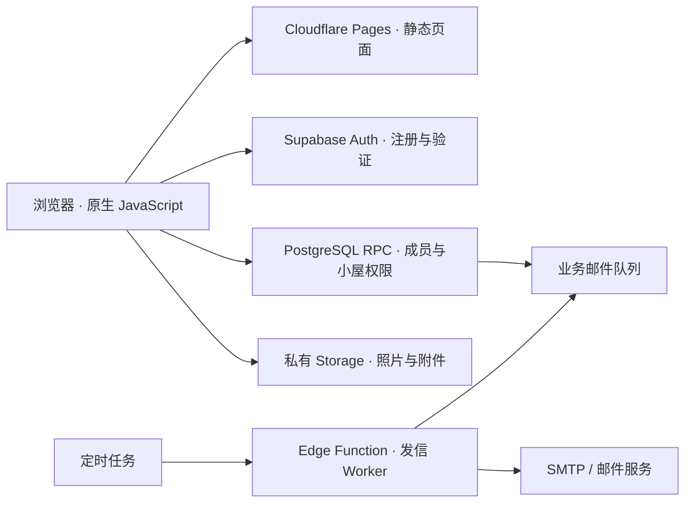

<div align="center">


# 我们的恋爱日记

**把想念、见面和日常，放进两个人的小屋。**

一个支持邮箱注册、邀请绑定与多小屋隔离的情侣日记应用。  
可以直接在线使用，也可以部署自己的站点。

[在线体验](https://couple-diary-v02.pages.dev/) · [部署指南](docs/DEPLOY.md) · [反馈与验收](docs/FEEDBACK.md)

[](https://github.com/zongemory-spec/couple_diary/actions/workflows/checks.yml)
[](LICENSE)

</div>

---

## 从注册到两个人的小屋

**邮箱注册并验证 → 创建小屋 → 邀请另一半 → 接受邀请，共同记录。**

维护者部署一次，其他情侣无需配置数据库或修改代码。每人最多加入一个小屋，每个小屋最多两位成员；不同小屋的日记、照片和附件按成员关系隔离。

> 当前为早期体验版本，正在收集实际使用反馈。欢迎报告注册、邀请、手机布局和记录同步方面的问题；提交反馈时请移除真实日记、邮箱和验证链接。

## 不只是记下一天

| 场景 | 可以一起做什么 |
| --- | --- |
| 💌 私密信箱 | 写信、收信，查看已读状态，把认真说的话留下来。 |
| ☁️ 心情小屋 | 分享心情与照片，回应另一半，在月度晴雨表里回看日常。 |
| 📷 共同回忆 | 记录标题、地点与事件，收藏照片，编辑和回看重要时刻。 |
| ✨ 心愿清单 | 收藏期待，把心愿安排进见面计划，实现后存入回忆。 |
| 🗓️ 见面约定 | 设置日期范围、地点和行程，查看倒计时，上传私密 Word / PDF 附件。 |
| 🎁 想你小铺 | 自定义商品，用“0 元心意订单”表达想念，支持回复和发货状态。 |
| 🌸 四季风景 | 樱花、花火、红叶与雪夜，适配手机，并提供减少动画设置。 |
| 🔔 邮件提醒 | 支持邀请、来信和日记事件通知，可关闭个人业务提醒。 |

小铺未接入真实支付或物流。外部商品链接跳转购物平台，实际交易由平台完成。

## 体验反馈与迭代

当前处于早期体验阶段，维护者已确认注册与登录恢复正常，正在收集体验反馈。其他真实服务验收仍按场景记录，不将自动测试通过等同全部线上验收完成。

[报告问题](https://github.com/zongemory-spec/couple_diary/issues/new?template=bug_report.yml) · [提出建议](https://github.com/zongemory-spec/couple_diary/issues/new?template=feature_request.yml) · [验收与处理记录](docs/FEEDBACK.md)

## 从独立部署到多人使用

项目最初面向一对情侣：每对情侣单独部署后台，由维护者预先配置两个账号。为了让没有部署经验的人也能使用，v0.2 将其调整为共享站点、多小屋模式。

这次迭代不只增加注册页，也重新设计了成员归属、邀请接受、文件授权和发信方式：

| 问题 | 当前实现 |
| --- | --- |
| 如何让用户自己开始使用？ | 邮箱验证后创建小屋，通过目标邮箱邀请另一半；资料确认和绑定在数据库事务内完成。 |
| 如何防止跨小屋读取？ | 服务端根据认证用户解析所属小屋，业务接口和私有文件规则校验成员关系，不信任浏览器传入的身份。 |
| 两人同时修改如何处理？ | 保存携带修订号，服务端检测冲突；提交编号用于识别重复请求。 |
| 照片和附件如何限制访问？ | 使用私有 Storage 存储桶，按上传者所属小屋授权，而非向所有登录用户开放。 |
| 邮件失败会不会丢日记？ | 业务提醒通过独立队列处理，采用租约、重试和发送限额；发信失败不回滚已保存的日记。 |
| 如何检查权限是否有效？ | 自动化测试覆盖两对情侣隔离、邀请、信件、记录保存及邮件队列等场景。 |

## 技术结构

前端使用原生 JavaScript、HTML 和 CSS；后端使用 Supabase Auth、PostgreSQL 与私有 Storage。Python 构建脚本将页面、样式、脚本和素材打包为静态网站，部署到 Cloudflare Pages。



注册确认和密码找回由 **Supabase Auth 的自定义 SMTP** 发送；邀请、来信和日记事件提醒由**业务邮件队列与 Edge Function** 处理，两者需要分别配置。

## 自己部署

需要 Node.js 24+、Python 3.12+，以及自己的 Supabase 项目。

1. 新建 Supabase 项目，运行 `database/install.sql`。
2. 开启邮箱注册和邮箱确认，配置 Auth SMTP。
3. 打开根目录的 `setup.html`，生成公开配置并替换 `site/config.js`；也可在构建环境中设置 `SUPABASE_URL` 和 `SUPABASE_PUBLISHABLE_KEY`。
4. 安装依赖、验证并构建：

```sh
npm ci --ignore-scripts
npm test
npm run build
```

5. 将 `dist/` 部署到 HTTPS 静态托管。Cloudflare Pages 构建命令为 `npm run build`，输出目录为 `dist`。
6. 取得网站地址后，在 Supabase 中配置 Site URL 和允许的 Redirect URLs，测试注册、验证与邀请流程。

业务提醒需要另外部署 `diary-mail` Edge Function 和定时任务。未配置业务发信时，可以复制邀请链接，站内功能仍可使用；注册确认邮件仍需 Auth SMTP。

| 文档 | 内容 |
| --- | --- |
| [部署指南](docs/DEPLOY.md) | 后台安装、公开配置、静态托管与回调地址 |
| [邮件配置](docs/MAIL.md) | 注册邮件、业务邮件、Secrets 与定时任务 |
| [联调清单](docs/CHECKS.md) | 使用真实邮箱和两对情侣验收服务 |
| [自动检查](docs/CI.md) | 测试、构建与网页产物 |
| [安全说明](SECURITY.md) | 敏感配置与安全问题反馈 |

公开 key 可以用于前端；数据库密码、Secret key、`service_role`、SMTP 授权码和任务密钥只能保存在后台。

## 验证与项目目录

GitHub Actions 在向 `main` 推送或提交 PR 时运行测试并构建网站。测试使用 PGlite 执行业务 SQL，结合模拟认证与接口测试，检查数据隔离和业务行为；不向真实邮箱发信，也不能替代真实 Supabase、Storage 和 SMTP 联调。

```text
site/                  前端页面、业务逻辑、样式与四季素材
database/             数据库安装、权限与邮件调度示例
supabase/functions/   业务邮件 Worker
tools/                离线配置生成与静态构建工具
tests/                数据库、权限与接口自动化测试
docs/                 部署、邮件与验收文档
setup.html            本地配置向导
```

## 当前边界

- 每人一个小屋，每屋两位成员；暂不提供解除绑定、换伴侣和账号自助注销入口。
- 维护者拥有后台管理权限，项目不属于端到端加密服务。
- 暂无管理员运营台、真实支付和自动备份恢复功能；实际使用需要自行安排备份。
- 邮件可能受供应商限额、风控和网络影响，接口成功不等于一定进入收件箱。
- 旧版单小屋数据库不能直接升级，当前没有旧记录自动导入工具，详见部署指南。
- 当前交付的是网页版，不包含与其功能对齐的微信原生小程序。

## 反馈与许可

欢迎通过 [Issues](https://github.com/zongemory-spec/couple_diary/issues) 提交问题。请说明操作步骤、预期结果和实际表现；截图使用测试数据，避免公开密码、授权码、验证链接或他人的私人内容。

代码采用 [MIT License](LICENSE)。字体及素材授权见 [FONT-LICENSE.txt](FONT-LICENSE.txt) 和 [THIRD_PARTY_NOTICES.md](THIRD_PARTY_NOTICES.md)。
